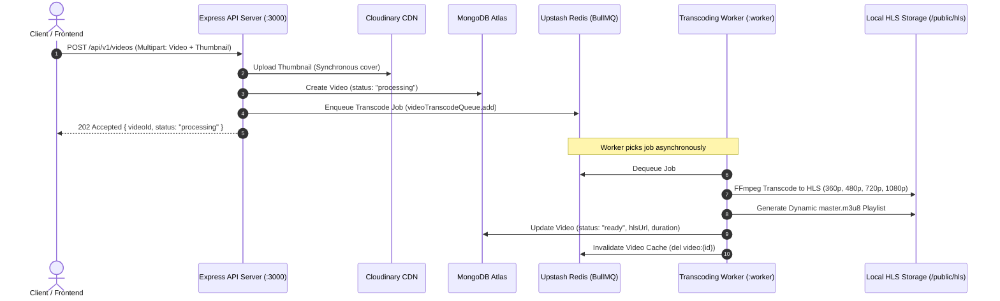
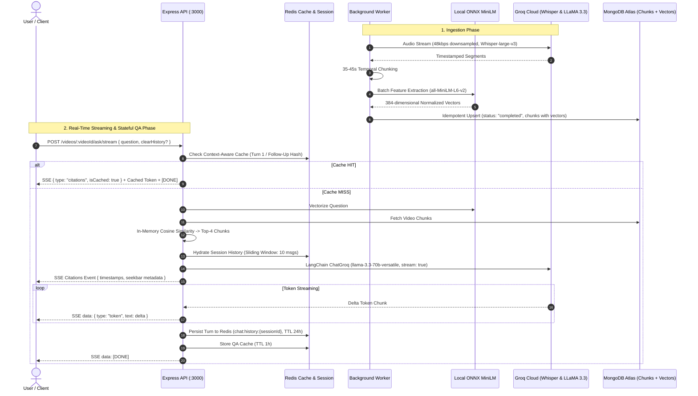

# VidVore - Distributed Video Streaming & Video Intelligence Infrastructure

[](https://github.com/Flamekaiser17/VidCore-/actions/workflows/node.js.yml)
[](http://localhost:3000/api-docs)
[](https://github.com/Flamekaiser17/VidCore-)
[](https://huggingface.co/Xenova/all-MiniLM-L6-v2)
[](https://developer.mozilla.org/en-US/docs/Web/API/Server-sent_events)
[](https://upstash.com)
[](https://bullmq.io)
[](https://ffmpeg.org)

VidVore is a production-grade, distributed backend infrastructure engineered for large-scale video platforms. It features an **asynchronous media ingestion & transcoding pipeline**, **multi-bitrate HLS streaming**, and an **enterprise-grade Video Intelligence RAG Pipeline** with local ONNX vector embeddings, distributed Redis conversational memory, and real-time Server-Sent Events (SSE) token streaming.

---

## 🏗️ System Architecture & Workflow

### 1. Asynchronous Video Transcoding & Ingestion

VidVore completely decouples video upload ingestion from heavy CPU-bound transcoding. Clients receive an immediate **HTTP 202 Accepted** response while background workers handle adaptive bitrate encoding and AI transcript indexing.



---

### 2. Stateful Temporal RAG & Video Intelligence Pipeline

VidVore transforms video archives into interactive conversational knowledge bases using a state-of-the-art Retrieval-Augmented Generation (RAG) architecture:



---

## ⚡ Key Engineering Highlights

| Component                   | Technology                           | Architectural Strategy                                                                                        |
| :-------------------------- | :----------------------------------- | :------------------------------------------------------------------------------------------------------------ |
| **Real-Time AI Streaming**  | Server-Sent Events (SSE), HTTP/2     | Token-by-token streaming with `AbortController` cancellation to eliminate compute waste on client disconnect. |
| **Local Vector Embeddings** | `@xenova/transformers`, ONNX Runtime | Offline 384-d vector extraction using `all-MiniLM-L6-v2` with zero API cost and sub-10ms batch latency.       |
| **Temporal Chunking**       | In-house chunker, Cosine Similarity  | 35–45s windowing with boundary-preserving timestamps (`startTime`, `endTime`) for exact seekbar citation.     |
| **Distributed Memory**      | Redis (`ioredis`), LangChain         | Session-isolated chat history (`chat:history:{userId}:{videoId}`) with 10-message sliding window and 24h TTL. |
| **Context-Aware Caching**   | Redis (`ioredis`), SHA-256           | Multi-turn cache partitioning (Turn 1 global cache vs Turn 2+ context-hashed keys) preventing collision.      |
| **Resilient Retries**       | Custom retry utility, Full Jitter    | Exponential backoff with full randomized jitter handling HTTP 429/503 and network timeouts.                   |
| **Media Transcoding**       | `fluent-ffmpeg`, HLS                 | Multi-variant HLS encoding (**360p, 480p, 720p, 1080p**) with dynamic master playlist (`master.m3u8`).        |
| **Distributed Queue**       | `bullmq`, `ioredis`                  | Asynchronous job processing with concurrency limits and dead-letter safety.                                   |
| **API Contract**            | `swagger-ui-express`, OpenAPI 3.0    | Complete interactive OpenAPI specification with streaming and seekbar payload documentation at `/api-docs`.   |
| **Authentication**          | Dual JWT (Access/Refresh)            | HTTP-only cookies, Bcrypt password hashing, and token rotation.                                               |

---

## 📡 AI Video Intelligence API Endpoints

### 1. Ask Video Query (Standard)

- **Endpoint:** `POST /api/v1/videos/:videoId/ask`
- **Headers:** `Authorization: Bearer <accessToken>`
- **Body:**
  ```json
  {
    "question": "Where does the speaker explain distributed locking?",
    "clearHistory": false
  }
  ```
- **Response (HTTP 200):**
  ```json
  {
    "statusCode": 200,
    "data": {
      "videoId": "67bf...",
      "question": "Where does the speaker explain distributed locking?",
      "answer": "The speaker covers distributed locking at [02:15] using Redis redlock...",
      "citations": [
        {
          "chunkIndex": 3,
          "startTime": 135,
          "endTime": 178,
          "formattedStartTime": "02:15",
          "formattedEndTime": "02:58",
          "score": 0.9124,
          "text": "..."
        }
      ],
      "isCached": false
    },
    "message": "AI query executed successfully",
    "success": true
  }
  ```

### 2. Ask Video Query (Real-Time SSE Stream)

- **Endpoint:** `POST /api/v1/videos/:videoId/ask/stream`
- **Headers:** `Authorization: Bearer <accessToken>`
- **Response Stream (`text/event-stream`):**

  ```
  data: {"type":"citations","citations":[{"formattedStartTime":"02:15","formattedEndTime":"02:58",...}],"isCached":false}

  data: {"type":"token","text":"The"}

  data: {"type":"token","text":" speaker"}

  data: {"type":"token","text":" explains"}

  data: [DONE]
  ```

### 3. Fetch Full Timestamped Transcript

- **Endpoint:** `GET /api/v1/videos/:videoId/transcript`
- **Response:** Returns all Whisper segments and precomputed vector chunks with timestamps.

---

## 📚 Interactive API Documentation (Swagger UI)

Explore and test all video, AI, and authentication endpoints interactively:

- **Swagger UI URL:** [`http://localhost:3000/api-docs`](http://localhost:3000/api-docs)
- **Features:**
  - One-click **Authorize (🔒)** using Bearer JWT tokens.
  - Interactive **Try It Out** for video transcoding, semantic AI search, and comment threads.
  - Real-time MongoDB & Redis infrastructure health metrics.

---

## 🚀 Getting Started

### Prerequisites

- **Node.js:** v18.0 or higher
- **FFmpeg:** System binary or `@ffmpeg-installer/ffmpeg`
- **MongoDB:** MongoDB Atlas cluster or local instance
- **Redis:** Upstash Redis TCP connection or local Redis

### 1. Installation

```bash
git clone https://github.com/Flamekaiser17/VidCore-.git
cd VidCore-
npm install
```

### 2. Configure Environment Variables

Copy `.env.example` to `.env` and fill in your credentials:

```bash
cp .env.example .env
```

```env
PORT=3000
MONGODB_URL=mongodb+srv://<username>:<password>@cluster0.mongodb.net
UPSTASH_REDIS_URL="rediss://default:<password>@<endpoint>.upstash.io:6379"

CLOUDINARY_CLOUD_NAME=your_cloud_name
CLOUDINARY_API_KEY=your_api_key
CLOUDINARY_API_SECRET=your_api_secret

GROQ_API_KEY=your_groq_api_key

ACCESS_TOKEN_SECRET=your_access_token_secret
ACCESS_TOKEN_EXPIRY=1d
REFRESH_TOKEN_SECRET=your_refresh_token_secret
REFRESH_TOKEN_EXPIRY=10d
CORS_ORIGIN=*
```

### 3. Run the Development Server

```bash
# Terminal 1: Start Express API Server with Nodemon
npm run dev
```

### 4. Run the Background Transcoding & Ingestion Worker

```bash
# Terminal 2: Start BullMQ Transcoding & AI Indexing Worker
npm run worker
```

---

## 🧪 Quality Assurance & Testing

Run automated connectivity and pipeline unit tests:

```bash
npm test
```

### CI/CD Pipeline

Every commit automatically triggers GitHub Actions to run:

- Code style and formatting checks via **Prettier**.
- Dual service container integration tests for **MongoDB** and **Redis**.

---

## 👨‍💻 Author

**Shivansh Rajput**  
_Full Stack Systems & AI Engineer_  
Specializing in Distributed Systems, Real-Time Streaming & Agentic AI Pipelines
