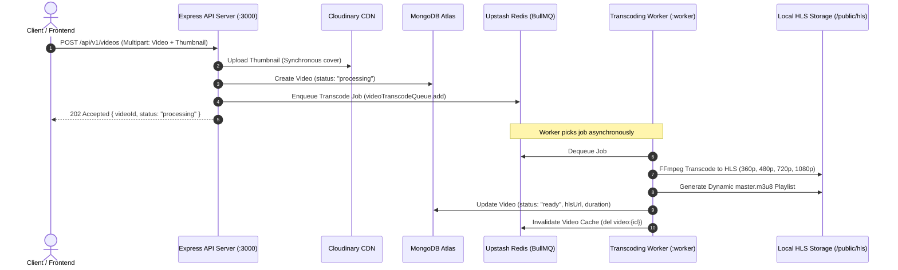

# VidVore - Distributed Video Streaming & Transcoding Infrastructure

[](https://github.com/Flamekaiser17/VidCore-/actions/workflows/node.js.yml)
[](http://localhost:3000/api-docs)
[](https://upstash.com)
[](https://bullmq.io)
[](https://ffmpeg.org)

VidVore is a production-grade, distributed backend infrastructure engineered for large-scale video platforms. It features an **asynchronous, non-blocking media ingestion pipeline**, **multi-bitrate HLS adaptive bitrate streaming**, **distributed BullMQ task queues**, and **sub-millisecond Redis caching**.

---

## 🏗️ System Architecture & Workflow

### 1. Asynchronous Video Transcoding Pipeline

VidVore completely decouples video upload ingestion from heavy CPU-bound transcoding. Clients receive an immediate **HTTP 202 Accepted** response while background workers handle adaptive bitrate encoding.



---

## ⚡ Key Engineering Highlights

| Component             | Technology                | Architectural Strategy                                                                                 |
| :-------------------- | :------------------------ | :----------------------------------------------------------------------------------------------------- |
| **Media Transcoding** | `fluent-ffmpeg`, HLS      | Multi-variant HLS encoding (**360p, 480p, 720p, 1080p**) with dynamic master playlist (`master.m3u8`). |
| **Distributed Queue** | `bullmq`, `ioredis`       | Job queue with exponential backoff (3 retries) and concurrency management.                             |
| **Caching Layer**     | `ioredis`, Upstash        | Sub-millisecond retrieval with TTL and write-through cache invalidation.                               |
| **API Contract**      | `swagger-ui-express`      | Full OpenAPI 3.0 specification with interactive testing at `/api-docs`.                                |
| **Authentication**    | Dual JWT (Access/Refresh) | Secure HTTP-only cookies, Bcrypt password hashing, and token rotation.                                 |
| **Database**          | MongoDB & Mongoose        | Aggregation pipelines, pagination, and multi-tenant indexing.                                          |

---

## 📚 Interactive API Documentation (Swagger UI)

VidVore includes an enterprise-grade OpenAPI 3.0 dashboard for exploring and testing endpoints:

- **Swagger UI URL:** [`http://localhost:3000/api-docs`](http://localhost:3000/api-docs)
- **Features:**
  - One-click **Authorize (🔒)** using Bearer JWT tokens.
  - Interactive **Try It Out** for video uploads, queries, comments, and analytics.
  - Real-time MongoDB & Redis infrastructure health metrics.

---

## 🚀 Getting Started

### Prerequisites

- **Node.js:** v18.0 or higher
- **FFmpeg:** System binary or `@ffmpeg-installer/ffmpeg`
- **MongoDB:** MongoDB Atlas cluster or local instance
- **Redis:** Upstash Redis TCP connection or local Redis

### 1. Installation

```bash
git clone https://github.com/Flamekaiser17/VidCore-.git
cd VidCore-
npm install
```

### 2. Configure Environment Variables

Copy `.env.example` to `.env` and fill in your credentials:

```bash
cp .env.example .env
```

```env
PORT=3000
MONGODB_URL=mongodb+srv://<username>:<password>@cluster0.mongodb.net
UPSTASH_REDIS_URL="rediss://default:<password>@<endpoint>.upstash.io:6379"

CLOUDINARY_CLOUD_NAME=your_cloud_name
CLOUDINARY_API_KEY=your_api_key
CLOUDINARY_API_SECRET=your_api_secret

ACCESS_TOKEN_SECRET=your_access_token_secret
ACCESS_TOKEN_EXPIRY=1d
REFRESH_TOKEN_SECRET=your_refresh_token_secret
REFRESH_TOKEN_EXPIRY=10d
CORS_ORIGIN=*
```

### 3. Run the Development Server

```bash
# Terminal 1: Start Express API Server with Nodemon
npm run dev
```

### 4. Run the Background Transcoding Worker

```bash
# Terminal 2: Start BullMQ Transcoding Worker
npm run worker
```

---

## 🧪 Quality Assurance & Testing

Run automated connectivity tests for MongoDB and Redis:

```bash
npm test
```

### CI/CD Pipeline

Every commit automatically triggers GitHub Actions to run:

- Code style and formatting checks via **Prettier**.
- Dual service container integration tests for **MongoDB** and **Redis**.

---

## 👨‍💻 Author

**Shivansh Rajput**  
_Full Stack Systems Engineer_  
Specializing in Distributed Systems, Cloud Architecture & Media Pipelines
